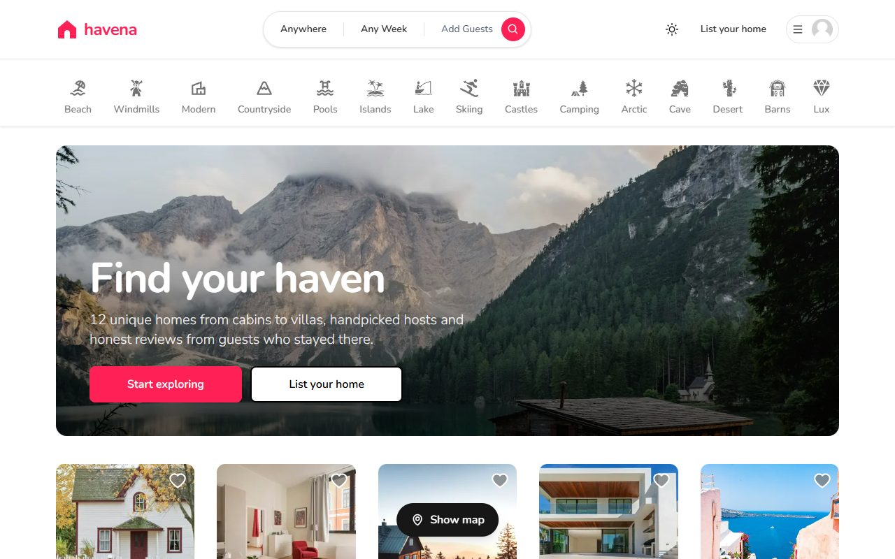
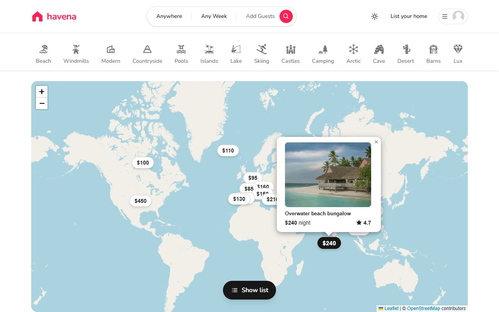
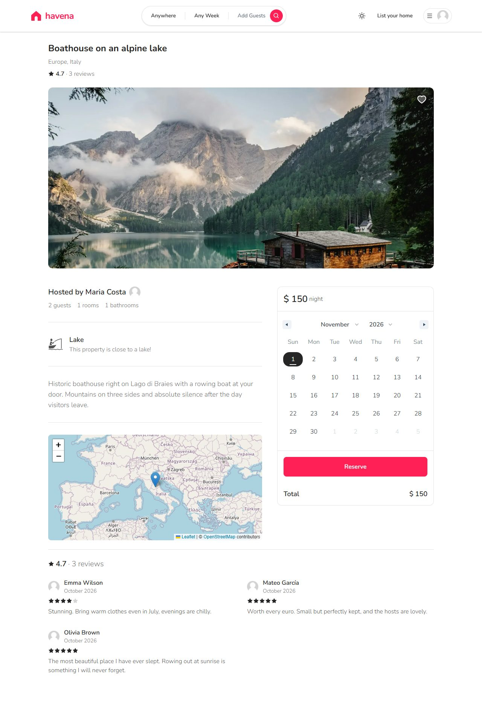
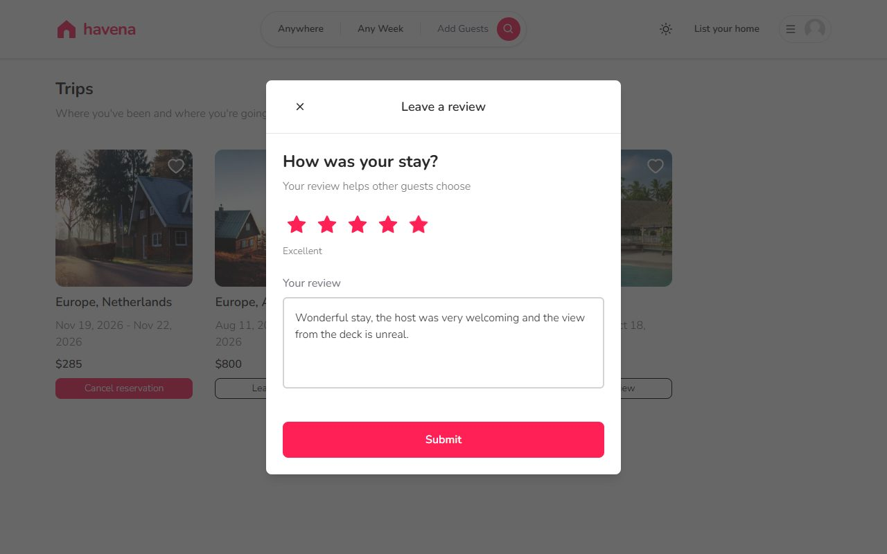
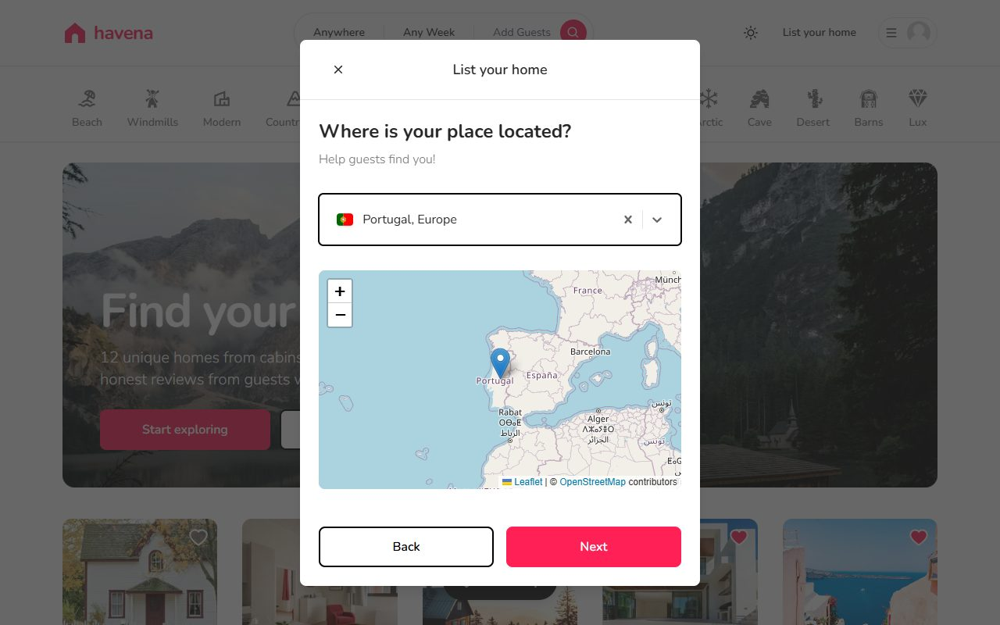
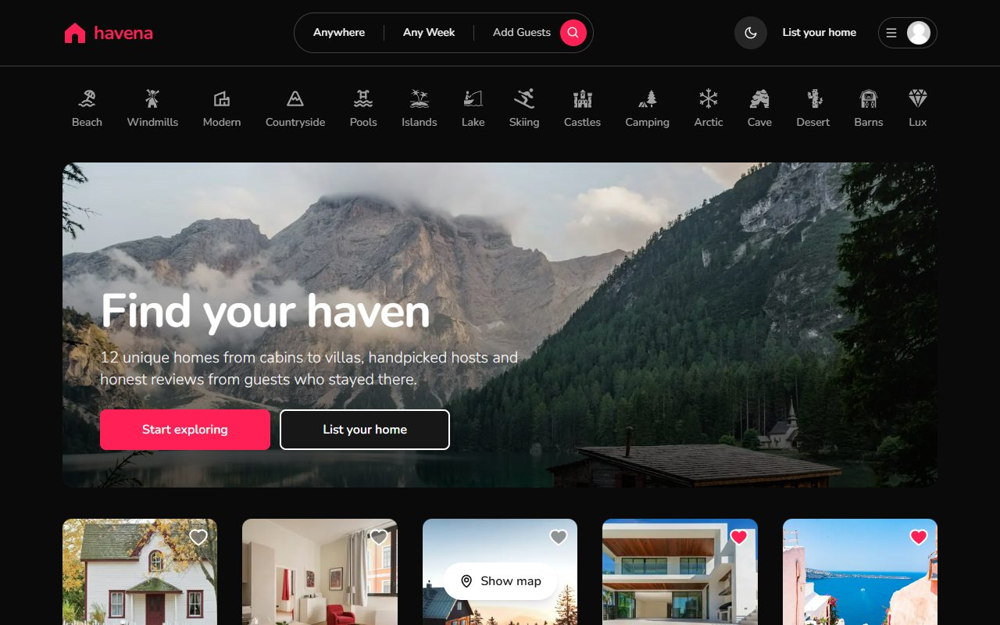

# Havena

**Havena** is a full-stack vacation rental booking platform: guests find and book unique places to stay, review them after the trip, and hosts list and manage their homes.

**Live demo:** [havena-booking.vercel.app](https://havena-booking.vercel.app)



## Try it

Log in with the demo account to see everything without registering:

| | |
|---|---|
| **Email** | `demo@havena.app` |
| **Password** | `havena-demo` |

The demo guest already has three finished stays without a review, so you can go to **My trips → Leave a review** right away, cancel the upcoming trip, browse favourites, or switch the home page to the **map view**. The demo data (hosts, listings, reviews) is recreated from a seed script, so feel free to experiment.

## Features

**For guests**
- Browse listings as a grid or on a **map with price markers**; filter by category, country, dates and number of guests
- Listing pages with photos, host, map, availability calendar and **guest reviews with an average rating**
- Book a stay; booked dates are blocked in the calendar and double bookings are rejected by the server
- **Review a place after the stay** (one review per guest per listing, only after a completed trip)
- Favourites and a trips page with cancellation for upcoming trips

**For hosts**
- List a home in a six-step form: category, location on a map, details, photo upload (Cloudinary), description, price
- **Edit** or delete your listings; see and cancel reservations on your properties

**Everyone**
- Sign up with email & password, or continue with GitHub / Google
- **Light and dark theme**, remembered across visits; the map switches to a dark basemap too

## Screenshots

| Map view | Listing page |
|---|---|
|  |  |

| Leaving a review | Listing form (location step) |
|---|---|
|  |  |



## How this project came to be

The first version was built step by step from a popular YouTube Airbnb-clone tutorial while I was learning Next.js (July–September 2026; the commit history reflects that). Everything after that is my own work, done as separate pull requests so each change can be reviewed on its own:

| PR | What changed |
|---|---|
| [#1](https://github.com/VladyslavBuilds/havena-booking/pull/1) | **Bug fixes.** Production build was broken (`middleware` → `proxy` for Next 16); date search showed booked listings (wrong interval-overlap check); double-submit created duplicate listings; form steps could be skipped; Leaflet markers failed on regular screens; a dozen typos in classes and texts |
| [#2](https://github.com/VladyslavBuilds/havena-booking/pull/2) | **Security.** The password hash was being sent to the browser; the API trusted the client for prices and dates. Added zod validation on every route, server-side price calculation and availability check, consistent `{ error }` responses with proper status codes |
| [#3](https://github.com/VladyslavBuilds/havena-booking/pull/3) | **Code quality.** ESLint from 30 problems to 0 (no `any`, React Compiler rules), server-rendered public pages instead of a client-only shell, Next 16 conventions |
| [#4](https://github.com/VladyslavBuilds/havena-booking/pull/4) | **Edit listings**, reusing the creation form in edit mode |
| [#5](https://github.com/VladyslavBuilds/havena-booking/pull/5) | **Reviews and ratings**: new model, API with business rules, star rating input, average rating on cards |
| [#6](https://github.com/VladyslavBuilds/havena-booking/pull/6) | **Rebrand** to Havena and a **demo data seed** |
| [#7](https://github.com/VladyslavBuilds/havena-booking/pull/7) | **Hero banner and map view** of the results; SVG country flags; design fixes |
| [#8](https://github.com/VladyslavBuilds/havena-booking/pull/8) | **Dark mode** with a themed map |
| [#9](https://github.com/VladyslavBuilds/havena-booking/pull/9) | Deployment to Vercel |

## Tech stack

- **Framework:** Next.js 16 (App Router, server components), React 19, TypeScript
- **Styling:** Tailwind CSS 4, `next-themes`
- **Database:** MongoDB Atlas with Prisma ORM
- **Auth:** NextAuth v4 (credentials with bcrypt, GitHub and Google OAuth)
- **Validation:** zod on every API route
- **UI libraries:** React Hook Form, Zustand, react-select, react-date-range, Leaflet / react-leaflet, react-hot-toast, react-icons
- **Media:** Cloudinary (unsigned uploads from the browser)
- **Hosting:** Vercel

## Project structure

```
app/
├── actions/        server-side data loading (getListings, getReviews, …)
├── api/            route handlers: listings, reservations, reviews, favorites, register
├── components/     UI, grouped by area: navbar/, modals/, inputs/, listings/
├── hooks/          Zustand stores for the modals, useFavorite, useCountries
├── libs/           Prisma client, API helpers, zod schemas, rating maths
├── types/          "Safe" (serialisable) versions of the Prisma models
└── <route>/        page.tsx (server) + <Route>Client.tsx (interactive part)
prisma/
├── schema.prisma   User, Account, Listing, Reservation, Review
└── seed.mjs        demo data
```

## Running locally

```bash
git clone https://github.com/VladyslavBuilds/havena-booking.git
cd havena-booking
npm install
cp .env.example .env     # fill in the values, see below
npx prisma db push       # creates collections and indexes in MongoDB
npm run db:seed          # optional: demo hosts, listings, reviews and the demo account
npm run dev
```

Open [http://localhost:3000](http://localhost:3000).

| Variable | Where to get it |
|---|---|
| `DATABASE_URL` | MongoDB Atlas → Connect → Drivers |
| `NEXTAUTH_SECRET` | any random string, e.g. `openssl rand -base64 32` |
| `NEXTAUTH_URL` | public URL in production (optional on Vercel) |
| `GITHUB_ID`, `GITHUB_SECRET` | GitHub → Settings → Developer settings → OAuth Apps; callback `<url>/api/auth/callback/github` |
| `GOOGLE_CLIENT_ID`, `GOOGLE_CLIENT_SECRET` | Google Cloud Console → Credentials; redirect URI `<url>/api/auth/callback/google` |
| `NEXT_PUBLIC_CLOUDINARY_CLOUD_NAME`, `NEXT_PUBLIC_UPLOAD_PRESET` | Cloudinary dashboard; the preset must allow unsigned uploads |

Scripts: `npm run dev`, `npm run build`, `npm run start`, `npm run lint`, `npm run db:seed` (re-running the seed resets the demo data).

## Quality

- `npm run lint`: 0 errors, 0 warnings (TypeScript strict, `@typescript-eslint`, React Compiler rules)
- Every pull request was verified with headless-browser walkthroughs (Playwright): the full guest and host flows, API rules with crafted requests (401/400/404/409), hydration checks in both themes

## Known limitations and ideas

- Listings store a country, not an address, so map markers are placed at the country centre (spread slightly when several listings share one)
- Two overlapping bookings sent at exactly the same instant can both pass the availability check (no transaction/lock yet)
- Ideas: multiple photos per listing, price filter and sorting, host dashboard with earnings, automated test suite in CI

## Credits

Demo photos from [Unsplash](https://unsplash.com). Map data © [OpenStreetMap](https://www.openstreetmap.org/copyright) contributors; dark basemap © [Esri](https://www.esri.com/).
